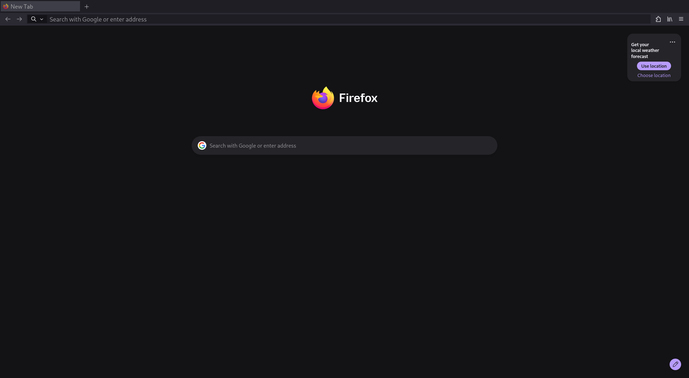

```
20261011 157.0

- docs/conf_20261011 (suggested configuration to make after installation)
- scripts/release.sh (source used to build the profile)
  -> chrome/userChrome.css
  -> prefs.js
  -> user.js

Note: On certain machines, this profile and/or its suggested
configuration may result in more frequent captchas and their
subsequent failures.

All distinct configuration files in the profile directory carried over
interactive configuration (not made by release.sh):
- customKeys.json
- prefs.js (cleaned by release.sh)
- shield-preference-experiments.json
- times.json

Peculiar personalized configuration in user.js that might be intrusive
to general usage, safe to remove:
- browser.display.document_color_use
- browser.display.use_document_fonts
- browser.download.dir
- browser.tabs.groups.enabled
- browser.nova.enabled
- browser.uidensity
- extensions.activeThemeID
- general.smoothScroll
- middlemouse.paste
- mousebutton.4th.enabled
- mousebutton.5th.enabled
- network.protocol-handler.external.mailto
- ui.key.menuAccessKey
- ui.key.menuAccessKeyFocuses
```

Quick download extension links:
- [CanvasBlocker](https://addons.mozilla.org/firefox/downloads/latest/canvasblocker/latest.xpi)
- [Get cookies.txt LOCALLY](https://addons.mozilla.org/firefox/downloads/latest/get-cookies-txt-locally/latest.xpi)
- [uBlock Origin](https://addons.mozilla.org/firefox/downloads/latest/ublock-origin/latest.xpi)
